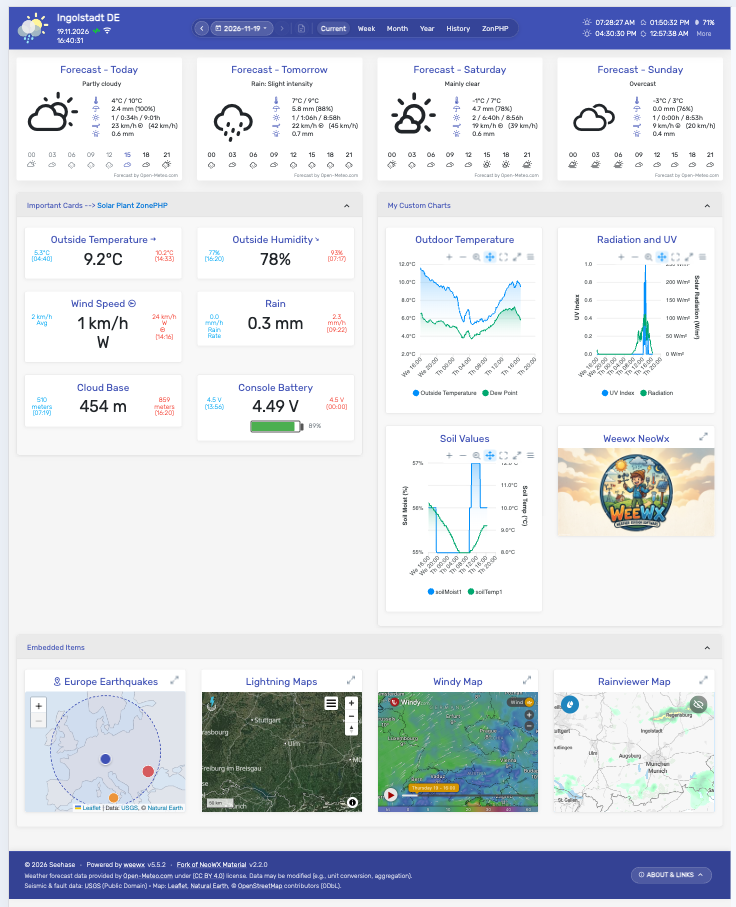

# NeoWX Material

**The most modern and feature-rich Material Design skin for WeeWX weather stations**

[](https://weewx.seehausen.org/)
[](https://github.com/seehase/neowx-material/issues)
[](LICENSE)

An actively maintained evolution of NeoWX Material featuring **interactive archive navigation**, **per-page collapsible layouts**, **real-time MQTT WebSocket updates**, **7-day Open-Meteo forecasts**, **multi-axis ApexCharts**, **station telemetry**, and **12 built-in languages**.

> **Live Demo:** [weewx.seehausen.org](https://weewx.seehausen.org/)



---

## 🎉 What's New in Release 2.0

- **🗓️ Interactive Archive Navigation & Date Pickers**: Adaptive header stepper controls (`<` / `>`) and Material dropdown calendar, week, month, and year pickers with `archive_start_date` bounds, proactive 404 protection, and one-click NOAA report access.
- **🗂️ Full Day & ISO Week Archives with Live-First Backfill (`NeowxArchiveGenerator`)**: Generates structured daily (`day-YYYY-MM-DD`), ISO weekly (`week-YYYY-WW`), monthly (`month-YYYY-MM`), and yearly (`year-YYYY`) archives in `archive/YYYY/...`. Current pages always render first (~5–10s), while missing historical pages backfill newest-to-oldest in batches across 5-minute cycles (`archive_batch_size`, `archive_max_run_time`, `archive_history`, `archive_start_date`).
- **🧩 Per-Page Section Layout (`[[[pages]]]` & `[[[sections]]]`)**: Explicitly define which sections appear on each page (`today`, `day`, `week`, `month`, `year`, `telemetry`) in exact top-to-bottom order. Wrap any group in a collapsible Material expansion panel (now also on **History** and **Almanac** pages) with persistent browser tab state.
- **🔌 Mix-and-Match Telemetry & Embedded Cards**: Place battery/voltage/signal gauges, telemetry charts, or embedded iFrames/images (Windy, RainViewer, Blitzortung, webcams) inside *any* card or chart section on *any* page.
- **⚡ Live Header/Footer Sync**: Archived pages stay up to date in the header and footer via `neowx-live.js` (`live.json`) without stale-value flashing.

---

## ✨ Core Highlights

- **🔴 Real-Time MQTT Updates**: Instant live sensor updates over WebSockets without page reload, configurable value-change flash animations, live connection indicator, and live updates for dashboard telemetry gauges. → [MQTT Guide](docs/MQTT.md)
- **📐 Configurable Responsive Grid & Balanced Row Packing**: Customize the 4 viewport breakpoints (`small`, `medium`, `large`, `desktop`), multi-column desktop bands (`desktop_columns = 1..5`), per-section `items_per_row` (from maximized single full-width items to 4+ per row), and automatic balanced row packing (`balance_rows`) across cards, charts, forecasts, telemetry, and embedded widgets. → [Layout Configuration Guide](docs/LAYOUT-CONFIGURATION.md)
- **⚙️ Powerful Configuration & Upgrade-Safe Patching**: Control 20+ Material color schemes, auto dark mode, cards, charts, and embedded widgets in `skin.conf`. Keep your customizations intact across skin upgrades with `config_patcher.py`. → [Configuration Guide](docs/CONFIGURATION.md) • [Config Patcher](docs/CONFIG-PATCHER.md)
- **🌍 12 Languages & Flexible Date Formatting**: Complete translations for Catalan, Danish, Dutch, English, Finnish, French, German, Italian, Polish, Slovak, Spanish, and Swedish, plus customizable date/time formats for cards and charts. → [Localization Guide](docs/LOCALIZATION.md) • [Date Formatting](docs/DATE-FORMATTING.md)
- **📊 Multi-Axis Interactive Charts & Trend Indicators**: Zoomable ApexCharts with multiple independent left/right Y-axes, fullscreen mode, wind rose, and unit-aware trend indicators (`multi` WMO/NWS, `davis`, `strict`). → [Multi-Axis Guide](docs/MULTI-AXIS-USAGE-GUIDE.md) • [Trend Indicators](docs/TREND-INDICATORS.md)
- **📡 Station Telemetry & 7-Day Weather Forecast**: Dedicated station health monitoring (battery status, voltage gauges, `rxCheckPercent` signal quality) and built-in 7-day [Open-Meteo](https://open-meteo.com) forecasts. → [Telemetry Guide](docs/TELEMETRY-CONFIG-GUIDE.md)

---

## 📥 Installation

1. **Install the extension:**
   ```bash
   weectl extension install https://github.com/seehase/neowx-material/archive/refs/heads/master.zip
   ```

2. **Enable the skin in `weewx.conf` (if not set automatically):**
   ```ini
   [StdReport]
       [[neowx-material]]
           skin = neowx-material
           enable = true
           lang = en  # ca, da, de, en, es, fi, fr, it, nl, pl, se, sk
   ```

3. **Restart WeeWX:**
   ```bash
   sudo systemctl restart weewx
   ```

> **Optional Enhanced Almanac:** Install [weewx-skyfield-almanac](https://github.com/roe-dl/weewx-skyfield-almanac) for extended sun, moon, planet, and twilight calculations on the Almanac page:
> ```bash
> weectl extension install https://github.com/roe-dl/weewx-skyfield-almanac/archive/master.zip
> ```

---

## ⚙️ Quick Configuration

All skin settings live under `[Extras]` and `[CheetahGenerator]` in `skins/neowx-material/skin.conf`:

- **Responsive Layout & Archives**: Customize breakpoints, balanced row packing (`[[[Layout]]]`), and page sections (`[[[pages]]]` / `[[[sections]]]`) under `[[Appearance]]`, and control historical archive generation under `[CheetahGenerator]`. See the [Layout Configuration Guide](docs/LAYOUT-CONFIGURATION.md) and [Configuration & Layout Guide](docs/CONFIGURATION.md).
- **Preserve Settings Across Updates**: Save your overrides in `skin.conf.patch` and apply them anytime:
  ```bash
  ./config_patcher.py skin.conf skin.conf.patch
  ```
  See the [Configuration Patcher Guide](docs/CONFIG-PATCHER.md).
- **Enable Live MQTT**: Set `enabled = true`, `host`, `port`, and `topic` under `[Extras] → [[MQTT]]`. See the [MQTT Setup Guide](docs/MQTT.md).

---

## 📚 Documentation

Detailed guides and references are located in the [`docs/`](docs/) directory:

| Guide | Description |
| :--- | :--- |
| **[Configuration & Layout Guide](docs/CONFIGURATION.md)** | Page/section layout (`[[[pages]]]`, `[[[sections]]]`), collapsible panels, Release 2.0 archive navigation & backfill (`archive_start_date`, `archive_history`, `archive_batch_size`), forecasts, and embedded iFrames/images |
| **[Layout Configuration Guide](docs/LAYOUT-CONFIGURATION.md)** | Configurable responsive breakpoints (`[[[Layout]]]`), multi-column desktop bands (`desktop_columns`), balanced row packing (`balance_rows`), and section-level `items_per_row` overrides |
| **[Configuration Patcher Guide](docs/CONFIG-PATCHER.md)** | Preserve your `skin.conf` customizations automatically across skin updates |
| **[MQTT Real-Time Updates Guide](docs/MQTT.md)** | Mosquitto/WebSocket setup, WeeWX MQTT extension, flash effects, and sensor mapping |
| **[Localization & Language Guide](docs/LOCALIZATION.md)** | Configuring the 12 supported languages, OS/systemd locales, and adding translations |
| **[Date & Time Formatting Guide](docs/DATE-FORMATTING.md)** | Customizing date/time formats on charts (`moment.js`) and cards (`strftime`) |
| **[Telemetry Configuration Guide](docs/TELEMETRY-CONFIG-GUIDE.md)** | Battery status, voltage gauges, signal quality (`rxCheckPercent`), and dashboard embedding |
| **[Voltage Battery Gauge Migration](docs/VOLTAGE-BATTERY-GAUGE-UPDATE.md)** | Migrating from binary battery status flags to voltage-based gauges |
| **[Multi-Axis Charts – Usage Guide](docs/MULTI-AXIS-USAGE-GUIDE.md)** | Combining observations with different scales on independent left/right Y-axes |
| **[Multi-Axis Charts – Quick Reference](docs/MULTI-AXIS-QUICK-REFERENCE.md)** | Compact cheat-sheet for `[[[[yaxis]]]]` and `[[[[yaxis_config]]]]` syntax |
| **[Trend Indicators Guide](docs/TREND-INDICATORS.md)** | Unit-aware current-page trend arrows, `trend_type` styles (`multi`, `davis`, `strict`), and thresholds |
| **[Regional Earthquakes Map Guide](docs/EARTHQUAKE-CONFIG.md)** | Configuring the interactive USGS earthquake map, fault lines overlay, offline vector/OSM basemaps, and custom coordinates |

---

## 👨‍💻 Development & Contributing

Contributions, bug reports, and translations are welcome! Open an issue or pull request on [GitHub](https://github.com/seehase/neowx-material/issues).

To build the SCSS stylesheet after editing files in `skins/neowx-material/scss/`:

```bash
cd skins/neowx-material
yarn install
yarn run build
```

---

## 📜 Credits & License

- **Maintained by:** [@seehase](https://github.com/seehase) and contributors.
- **Original Skin:** Based on [NeoWX Material](https://github.com/neoground/neowx-material) by Neoground GmbH.
- **Built With & Data Sources:**
  - [WeeWX](https://weewx.com), Material Design for Bootstrap (MDB), [ApexCharts](https://apexcharts.com), [MomentJS](https://momentjs.com), [Weather Icons](https://erikflowers.github.io/weather-icons/), and Paho MQTT.
  - **Weather Forecast:** [Open-Meteo API](https://open-meteo.com) ([CC BY 4.0](https://creativecommons.org/licenses/by/4.0/)).
  - **Regional Earthquakes & Maps:** [Leaflet 1.9.4](https://leafletjs.com/) (BSD-2-Clause), [USGS Earthquake Hazards Program & Quaternary Fault and Fold Database](https://earthquake.usgs.gov/) (U.S. Public Domain), [Natural Earth](https://www.naturalearthdata.com/) vector basemap (Public Domain), and [OpenStreetMap](https://www.openstreetmap.org/copyright) contributors (ODbL).
- **License:** Distributed under the original [LICENSE](LICENSE).
